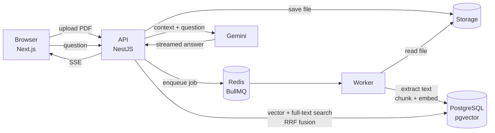

# PDF Assistant

Upload a PDF and chat with it. Answers are grounded in the document, streamed in real time, and every claim cites the page it came from — click a citation and the PDF viewer jumps straight to it.

Built as a full-stack RAG (Retrieval-Augmented Generation) application with a queue-based ingestion pipeline and hybrid search.


## Features

- **PDF upload & background processing** — uploads return instantly; text extraction, chunking and embedding run in a separate worker.
- **Hybrid search** — semantic search (pgvector) and full-text search (PostgreSQL `tsvector`) combined with **Reciprocal Rank Fusion**, so both meaning-based questions and exact terms (names, emails, acronyms) are found.
- **Streaming answers** — responses arrive token by token over Server-Sent Events.
- **Page-level citations** — each answer references its sources; clicking `[n]` opens that page in the built-in PDF preview.
- **Local embeddings** — `multilingual-e5-small` runs on the server via Transformers.js; only the final answer generation calls an LLM (Google Gemini).
- **Bilingual UI** — Portuguese and English.

## Architecture



**Ingestion:** `upload → file stored → job queued → worker extracts text per page → word-aligned overlapping chunks → 384-d embeddings → PostgreSQL`

**Question answering:** `question → query embedding → top-20 vector hits + top-20 keyword hits → RRF → top-5 chunks → Gemini → streamed answer with sources`

### Design decisions

| Decision | Why |
| --- | --- |
| Queue + separate worker | Embedding a large PDF takes seconds to minutes. Keeping it out of the request cycle keeps the API responsive and lets ingestion scale independently. |
| Hybrid search with RRF | Pure vector search struggles with exact tokens like emails, IDs or proper nouns; pure keyword search misses paraphrases. RRF merges both rankings without needing to calibrate their scores. |
| Chunks never span pages | Every chunk belongs to exactly one page, so citations always point to the right place. |
| Local embedding model | No per-token cost for indexing, and documents are not sent to a third party just to be indexed. |
| pgvector instead of a dedicated vector DB | One database for documents, chunks, vectors and full-text indexes — simpler to operate and query. |

## Tech stack

| Layer | Technology |
| --- | --- |
| Frontend | Next.js 16, React 19, Tailwind CSS 4, shadcn/ui |
| API | NestJS, TypeORM, Multer |
| Worker | Node.js, BullMQ, unpdf |
| AI | Transformers.js (`Xenova/multilingual-e5-small`), Google Gemini |
| Data | PostgreSQL 16 + pgvector, Redis 7 |
| Tooling | Turborepo, pnpm workspaces, Docker Compose, Jest |

## Project structure

```
apps/
  web/      Next.js frontend (upload, PDF preview, chat)
  api/      NestJS REST API (upload, search, chat streaming)
  worker/   BullMQ consumer (PDF extraction, chunking, embeddings)
packages/
  db/       TypeORM entities, data source and queue names (shared by api + worker)
  ai/       Embeddings and Gemini answer generation (shared by api + worker)
docker/     Database init scripts
```

## Getting started

### Prerequisites

- Node.js 24+
- pnpm (`corepack enable`)
- Docker
- A [Google Gemini API key](https://aistudio.google.com/apikey)

### Setup

```bash
# 1. Install dependencies
pnpm install

# 2. Configure environment
cp .env.example .env                          # then set GEMINI_API_KEY and STORAGE_PATH
cp apps/web/.env.example apps/web/.env.local

# 3. Start PostgreSQL (port 5433) and Redis (port 6379)
docker compose up -d

# 4. Run each app (separate terminals)
pnpm --filter api start:dev     # http://localhost:3001
pnpm --filter worker dev
pnpm --filter web dev           # http://localhost:3000

# 5. Once the API has created the tables, add the full-text search column (one time)
docker compose exec -T postgres psql -U pdf -d pdf_assistant < packages/db/sql/001_document_chunks_tsv.sql
```

> The first ingestion downloads the embedding model (~120 MB), so it takes a bit longer.

### Environment variables

| Variable | Description |
| --- | --- |
| `DATABASE_URL` | PostgreSQL connection string |
| `REDIS_URL` | Redis connection string |
| `PORT` | API port (default `3001`) |
| `STORAGE_PATH` | Folder where uploaded PDFs are stored |
| `GEMINI_API_KEY` | Google Gemini API key |
| `GEMINI_MODEL` | Gemini model used for answers |
| `NEXT_PUBLIC_API_URL` | API URL used by the frontend (`apps/web/.env.local`) |

## API

| Method | Endpoint | Description |
| --- | --- | --- |
| `POST` | `/documents/upload` | Upload a PDF (`multipart/form-data`, field `file`, max 50 MB) |
| `GET` | `/documents` | List documents |
| `GET` | `/documents/:id` | Document details and processing status |
| `GET` | `/documents/:id/file` | Original PDF |
| `GET` | `/documents/:id/search?q=` | Hybrid search over the document's chunks |
| `POST` | `/documents/:id/chat` | Ask a question (JSON response) |
| `POST` | `/documents/:id/chat/stream` | Ask a question (Server-Sent Events) |

## Tests

```bash
pnpm --filter api test
```

## Roadmap

- [ ] Database migrations (replace `synchronize`)
- [ ] Authentication and per-user documents
- [ ] Delete documents
- [ ] Retrieval evaluation set to measure answer quality
- [ ] Multi-document chat

## Author

**Pedro Pinho** — [GitHub](https://github.com/PedroPinho17)
