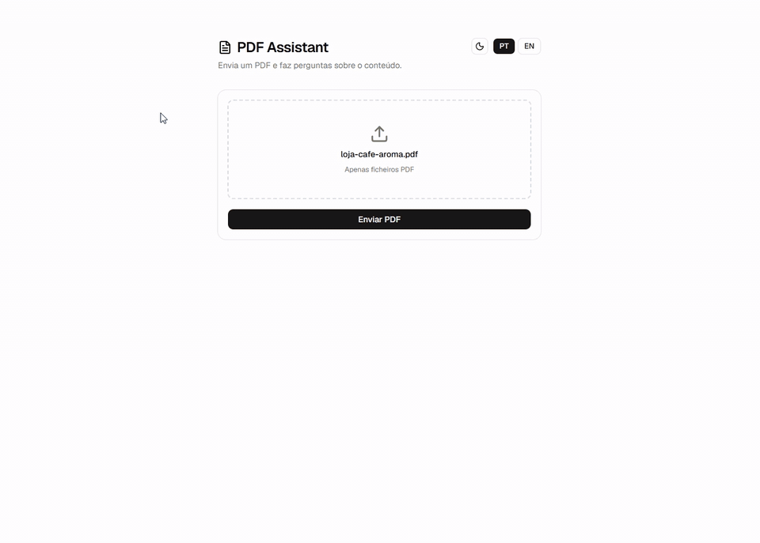
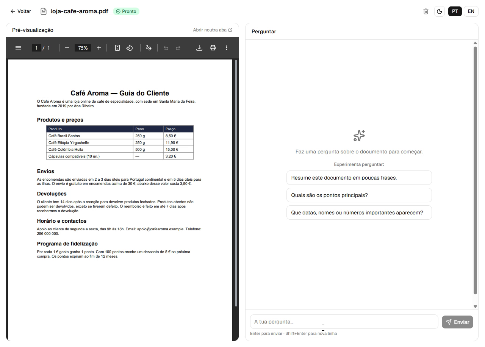
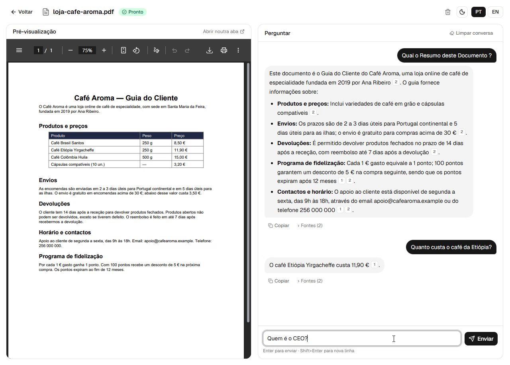
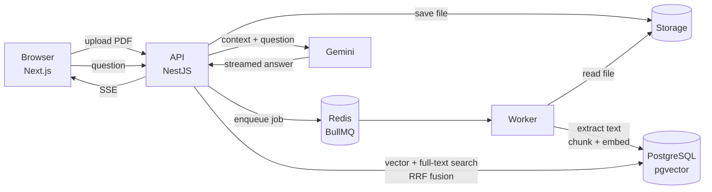

# PDF Assistant

Upload a PDF and chat with it. Answers are grounded in the document, streamed in real time, and every claim cites the page it came from — click a citation and the PDF viewer jumps straight to it.

Built as a full-stack RAG (Retrieval-Augmented Generation) application with a queue-based ingestion pipeline and hybrid search.

<p align="center">
  
</p>
<p align="center"><sub>Demo at 2× speed · <a href="docs/media/demo.mp4">full-quality video</a> · sample document: a fictional coffee shop guide</sub></p>


## Features

- **PDF upload & background processing** — uploads return instantly; text extraction, chunking and embedding run in a separate worker.
- **Hybrid search** — semantic search (pgvector) and full-text search (PostgreSQL `tsvector`) combined with **Reciprocal Rank Fusion**, so both meaning-based questions and exact terms (names, emails, acronyms) are found.
- **Streaming answers** — responses arrive token by token over Server-Sent Events.
- **Page-level citations** — each answer references its sources; clicking `[n]` opens that page in the built-in PDF preview.
- **Local embeddings** — `multilingual-e5-small` runs on the server via Transformers.js; only the final answer generation calls an LLM (Google Gemini).
- **Private accounts** — sign up with email and password; each user only ever sees their own documents and chats (see [Security](#security)).
- **Persistent conversations** — chat history is stored per document and survives page reloads.
- **Answers in your language** — the model replies in the language of the question, whatever the document's language.
- **Polished UI** — drag & drop upload, suggested questions, copy answers, dark mode, Portuguese and English.

## Screenshots

| Suggested questions on a new document | Cited answers with clickable sources |
| --- | --- |
|  |  |

## Architecture



**Ingestion:** `upload → file stored → job queued → worker extracts text per page → word-aligned overlapping chunks → 384-d embeddings → PostgreSQL`

**Question answering:** `question → query embedding → top-20 vector hits + top-20 keyword hits → RRF → top-5 chunks → Gemini → streamed answer with sources`

### Design decisions

| Decision | Why |
| --- | --- |
| Queue + separate worker | Embedding a large PDF takes seconds to minutes. Keeping it out of the request cycle keeps the API responsive and lets ingestion scale independently. |
| Hybrid search with RRF | Pure vector search struggles with exact tokens like emails, IDs or proper nouns; pure keyword search misses paraphrases. RRF merges both rankings without needing to calibrate their scores. |
| Chunks never span pages | Every chunk belongs to exactly one page, so citations always point to the right place. |
| Local embedding model | No per-token cost for indexing, and documents are not sent to a third party just to be indexed. |
| pgvector instead of a dedicated vector DB | One database for documents, chunks, vectors and full-text indexes — simpler to operate and query. |
| HNSW + GIN + `documentId` indexes | HNSW (`vector_cosine_ops`) keeps semantic search fast on large documents, GIN does the same for full-text, and a B-tree on `documentId` serves the per-document filter. pgvector's iterative scan guarantees enough results when filtering an HNSW scan. |

## Tech stack

| Layer | Technology |
| --- | --- |
| Frontend | Next.js 16, React 19, Tailwind CSS 4, shadcn/ui |
| API | NestJS, TypeORM, Multer |
| Worker | Node.js, BullMQ, unpdf |
| AI | Transformers.js (`Xenova/multilingual-e5-small`), Google Gemini |
| Data | PostgreSQL 16 + pgvector, Redis 7 |
| Tooling | Turborepo, pnpm workspaces, Docker Compose, Jest |

## Project structure

```
apps/
  web/      Next.js frontend (upload, PDF preview, chat)
  api/      NestJS REST API (upload, search, chat streaming)
  worker/   BullMQ consumer (PDF extraction, chunking, embeddings)
packages/
  db/       TypeORM entities, data source and queue names (shared by api + worker)
  ai/       Embeddings and Gemini answer generation (shared by api + worker)
docker/     Database init scripts
```

## Getting started

### Prerequisites

- Node.js 24+
- pnpm (`corepack enable`)
- Docker
- A [Google Gemini API key](https://aistudio.google.com/apikey)

### Setup

```bash
# 1. Install dependencies
pnpm install

# 2. Configure environment — then fill in GEMINI_API_KEY, STORAGE_PATH and
#    replace every "change-me" / empty secret (commands to generate them are in the file)
cp .env.example .env
cp apps/web/.env.example apps/web/.env.local

# 3. Start PostgreSQL (port 5433) and Redis (port 6379), bound to localhost only
docker compose up -d

# 4. Build the shared packages (@repo/db, @repo/ai) — repeat after changing them,
#    or use `pnpm dev` at the root, which rebuilds them in watch mode
pnpm --filter "./packages/*" build

# 5. Run each app (separate terminals)
pnpm --filter api start:dev     # http://localhost:3001
pnpm --filter worker dev
pnpm --filter web dev           # http://localhost:3000  → create an account

# 6. Once the API has created the tables, add the full-text column and search indexes (one time)
for f in packages/db/sql/*.sql; do docker compose exec -T postgres psql -U pdf -d pdf_assistant < "$f"; done
```

> The first ingestion downloads the embedding model (~120 MB), so it takes a bit longer.

### Environment variables

| Variable | Description |
| --- | --- |
| `DATABASE_URL` | PostgreSQL connection string |
| `POSTGRES_USER` / `POSTGRES_PASSWORD` / `POSTGRES_DB` | Database credentials used by Docker Compose |
| `REDIS_PASSWORD` | Redis password (Redis refuses unauthenticated clients) |
| `REDIS_URL` | Redis connection string, including the password |
| `PORT` | API port (default `3001`) |
| `WEB_ORIGIN` | Web app origin — CORS, cookies and which site may embed PDFs |
| `JWT_SECRET` | Secret that signs session cookies (32+ random characters) |
| `NODE_ENV` | `production` enables secure cookies and disables schema auto-sync |
| `STORAGE_PATH` | Folder where uploaded PDFs are stored |
| `MAX_PDF_PAGES` | Maximum pages per document (default `500`) |
| `GEMINI_API_KEY` | Google Gemini API key |
| `GEMINI_MODEL` | Gemini model used for answers |
| `NEXT_PUBLIC_API_URL` | API URL used by the frontend (`apps/web/.env.local`) |

## API

All `/documents` routes require a session and only ever return the caller's own documents.

| Method | Endpoint | Description |
| --- | --- | --- |
| `POST` | `/auth/register` | Create an account and start a session |
| `POST` | `/auth/login` | Start a session (sets an httpOnly cookie) |
| `POST` | `/auth/logout` | End the session |
| `GET` | `/auth/me` | Current user |
| `POST` | `/documents/upload` | Upload a PDF (`multipart/form-data`, field `file`, max 25 MB) |
| `GET` | `/documents` | List your documents |
| `GET` | `/documents/:id` | Document details and processing status |
| `GET` | `/documents/:id/file` | Original PDF |
| `GET` | `/documents/:id/search?q=` | Hybrid search over the document's chunks |
| `POST` | `/documents/:id/chat` | Ask a question (JSON response) |
| `POST` | `/documents/:id/chat/stream` | Ask a question (Server-Sent Events) |
| `GET` | `/documents/:id/messages` | Saved conversation |
| `DELETE` | `/documents/:id/messages` | Clear the conversation |
| `DELETE` | `/documents/:id` | Delete a document, its chunks, chat and file |

Chat endpoints accept `{ "question": string (max 1000 chars), "locale"?: "pt" | "en" }`.

## Security

| Area | Measure |
| --- | --- |
| **Authentication** | Email + password accounts. Passwords hashed with **scrypt** (per-user salt, constant-time comparison). Login takes the same time whether or not the email exists, so accounts can't be enumerated. |
| **Sessions** | Signed JWT (HS256, 7 days) in an **httpOnly, SameSite=Lax** cookie (`Secure` in production) — unreadable by JavaScript and not sent on cross-site POSTs. |
| **Authorization** | A global guard protects every route by default; public routes opt out explicitly. Every query is scoped to the owner, and another user's document returns **404**, not 403, so IDs can't be probed. |
| **Rate limiting** | `@nestjs/throttler`: 120 req/min per IP overall, 5/min on login/register (brute force), 15/min on chat and 10/min on upload (protects the Gemini budget). |
| **Upload validation** | Only files that **start with the `%PDF-` signature** are accepted — MIME type and extension are client-controlled. Max 25 MB, max `MAX_PDF_PAGES` pages. Files are stored under random UUID names, never the user's filename. |
| **Input limits** | Questions capped at 1000 characters; UUIDs validated on every route. |
| **Injection** | All SQL is parameterized. LLM answers are rendered without `innerHTML`, so model output can't inject scripts. |
| **Prompt injection** | Rules live in Gemini's **system instruction**, document excerpts are wrapped in `<document>` tags and declared untrusted. *Known limitation:* no prompt-injection defence is perfect — a crafted PDF could still bias an answer about itself. Impact is limited because the model has no tools and no access to other data. |
| **Error handling** | Internal errors are logged server-side; clients get generic messages. |
| **HTTP headers** | `helmet`: `nosniff`, HSTS, `frame-ancestors` restricted to the web app, no `X-Powered-By`. PDFs are served `private, no-store`. CORS allows only `WEB_ORIGIN`. |
| **Infrastructure** | PostgreSQL and Redis listen on **127.0.0.1 only**; Redis requires a password. Secrets live in `.env`, which is git-ignored. Schema auto-sync is disabled when `NODE_ENV=production`. |

## Tests

```bash
pnpm --filter api test
```

## Roadmap

- [ ] Database migrations (replace dev-only `synchronize`)
- [ ] Email verification and password reset
- [ ] Support Word and other formats (convert to PDF with LibreOffice)
- [ ] OCR for scanned PDFs
- [ ] Retrieval evaluation set to measure answer quality
- [ ] Multi-document chat

## Author

**Pedro Pinho** — [GitHub](https://github.com/PedroPinho17)
