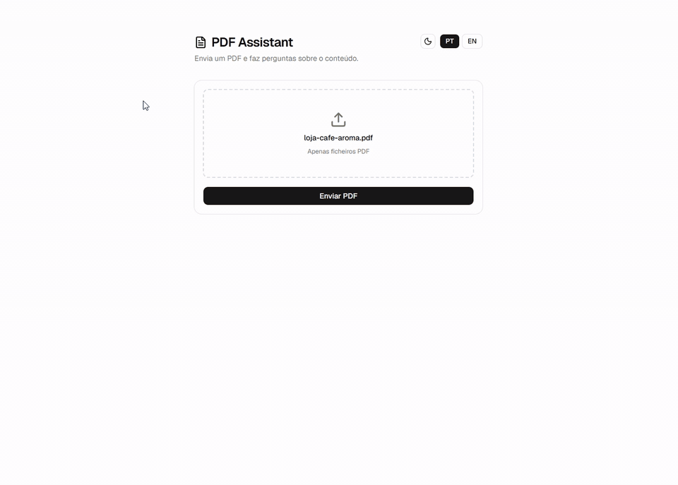
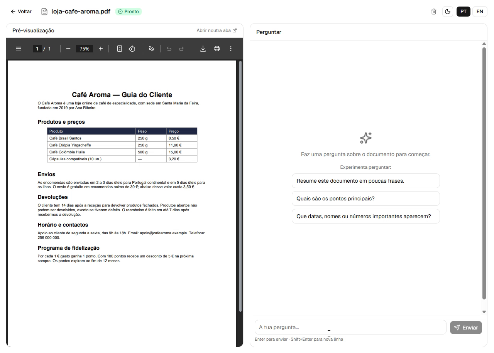
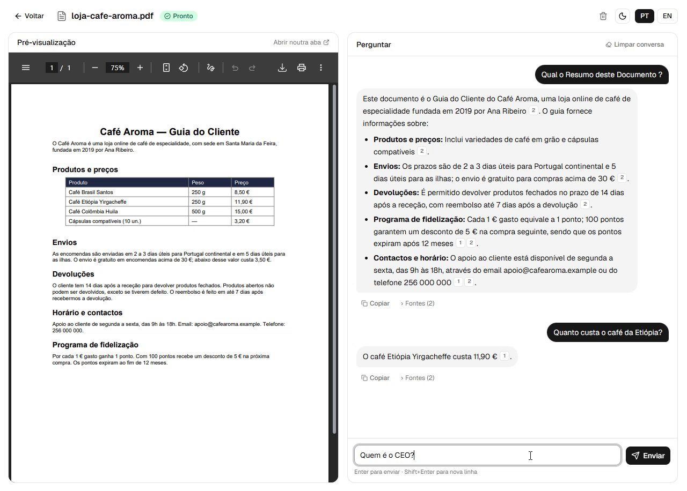
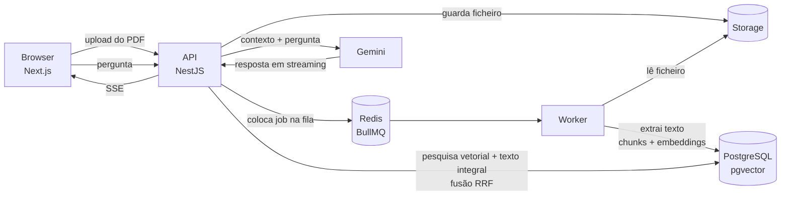

# PDF Assistant

<p align="right"><a href="README.md">English</a> · <b>Português</b></p>

Carregue um PDF e converse com ele. As respostas baseiam-se no documento, chegam em tempo real e cada afirmação cita a página de onde veio — clique numa citação e o visualizador de PDF salta diretamente para ela.

Construída como uma aplicação RAG (Retrieval-Augmented Generation) full-stack, com um pipeline de ingestão baseado em filas e pesquisa híbrida.

<p align="center">
  
</p>
<p align="center"><sub>Demo a velocidade 2× · <a href="docs/media/demo.mp4">vídeo em qualidade total</a> · documento de exemplo: um guia fictício de uma cafetaria</sub></p>


## Funcionalidades

- **Upload de PDF e processamento em segundo plano** — o upload responde de imediato; a extração de texto, divisão em chunks e geração de embeddings correm num worker separado.
- **Pesquisa híbrida** — pesquisa semântica (pgvector) e pesquisa de texto integral (PostgreSQL `tsvector`) combinadas com **Reciprocal Rank Fusion**, para encontrar tanto perguntas baseadas no significado como termos exatos (nomes, emails, siglas).
- **Respostas em streaming** — as respostas chegam token a token via Server-Sent Events.
- **Citações por página** — cada resposta indica as suas fontes; clicar em `[n]` abre essa página na pré-visualização de PDF integrada.
- **Embeddings locais** — o `multilingual-e5-small` corre no servidor via Transformers.js; apenas a geração da resposta final chama um LLM (Google Gemini).
- **Contas privadas** — registo com email e palavra-passe; cada utilizador só vê os seus próprios documentos e conversas (ver [Segurança](#segurança)).
- **Conversas persistentes** — o histórico do chat é guardado por documento e sobrevive a recarregamentos da página.
- **Respostas na sua língua** — o modelo responde na língua da pergunta, seja qual for a língua do documento.
- **Interface cuidada** — upload por arrastar e largar, perguntas sugeridas, copiar respostas, modo escuro, português e inglês.

## Capturas de ecrã

| Perguntas sugeridas num documento novo | Respostas com fontes clicáveis |
| --- | --- |
|  |  |

## Arquitetura



**Ingestão:** `upload → ficheiro guardado → job na fila → worker extrai texto por página → chunks sobrepostos alinhados por palavra → embeddings de 384 dimensões → PostgreSQL`

**Resposta a perguntas:** `pergunta → embedding da pergunta → top-20 resultados vetoriais + top-20 por palavra-chave → RRF → top-5 chunks → Gemini → resposta em streaming com fontes`

### Decisões de design

| Decisão | Porquê |
| --- | --- |
| Fila + worker separado | Gerar embeddings de um PDF grande demora de segundos a minutos. Mantê-lo fora do ciclo do pedido mantém a API responsiva e permite escalar a ingestão de forma independente. |
| Pesquisa híbrida com RRF | A pesquisa vetorial pura tem dificuldade com tokens exatos como emails, IDs ou nomes próprios; a pesquisa por palavra-chave pura falha paráfrases. O RRF junta os dois rankings sem ser preciso calibrar as pontuações. |
| Chunks nunca atravessam páginas | Cada chunk pertence a exatamente uma página, por isso as citações apontam sempre para o sítio certo. |
| Modelo de embeddings local | Sem custo por token na indexação, e os documentos não são enviados a terceiros só para serem indexados. |
| pgvector em vez de uma base de dados vetorial dedicada | Uma só base de dados para documentos, chunks, vetores e índices de texto integral — mais simples de operar e consultar. |
| Índices HNSW + GIN + `documentId` | O HNSW (`vector_cosine_ops`) mantém a pesquisa semântica rápida em documentos grandes, o GIN faz o mesmo para o texto integral, e uma B-tree em `documentId` serve o filtro por documento. O iterative scan do pgvector garante resultados suficientes ao filtrar uma pesquisa HNSW. |

## Stack tecnológica

| Camada | Tecnologia |
| --- | --- |
| Frontend | Next.js 16, React 19, Tailwind CSS 4, shadcn/ui |
| API | NestJS, TypeORM, Multer |
| Worker | Node.js, BullMQ, unpdf |
| IA | Transformers.js (`Xenova/multilingual-e5-small`), Google Gemini |
| Dados | PostgreSQL 16 + pgvector, Redis 7 |
| Ferramentas | Turborepo, pnpm workspaces, Docker Compose, Jest |

## Estrutura do projeto

```
apps/
  web/      Frontend Next.js (upload, pré-visualização do PDF, chat)
  api/      API REST NestJS (upload, pesquisa, streaming do chat)
  worker/   Consumidor BullMQ (extração do PDF, chunks, embeddings)
packages/
  db/       Entidades TypeORM, data source e nomes das filas (partilhado por api + worker)
  ai/       Embeddings e geração de respostas com Gemini (partilhado por api + worker)
docker/     Scripts de inicialização da base de dados
```

## Como começar

### Pré-requisitos

- Node.js 24+
- pnpm (`corepack enable`)
- Docker
- Uma [chave de API do Google Gemini](https://aistudio.google.com/apikey)

### Configuração

```bash
# 1. Instalar dependências
pnpm install

# 2. Configurar o ambiente — depois preencher GEMINI_API_KEY, STORAGE_PATH e
#    substituir todos os "change-me" / segredos vazios (os comandos para os gerar estão no ficheiro)
cp .env.example .env
cp apps/web/.env.example apps/web/.env.local

# 3. Arrancar o PostgreSQL (porta 5433) e o Redis (porta 6379), apenas em localhost
docker compose up -d

# 4. Compilar os pacotes partilhados (@repo/db, @repo/ai) — repetir após alterá-los,
#    ou usar `pnpm dev` na raiz, que os recompila em modo watch
pnpm --filter "./packages/*" build

# 5. Correr cada app (terminais separados)
pnpm --filter api start:dev     # http://localhost:3001
pnpm --filter worker dev
pnpm --filter web dev           # http://localhost:3000  → criar uma conta

# 6. Depois de a API criar as tabelas, adicionar a coluna de texto integral e os índices de pesquisa (uma vez)
for f in packages/db/sql/*.sql; do docker compose exec -T postgres psql -U pdf -d pdf_assistant < "$f"; done
```

> A primeira ingestão descarrega o modelo de embeddings (~120 MB), por isso demora um pouco mais.

### Variáveis de ambiente

| Variável | Descrição |
| --- | --- |
| `DATABASE_URL` | String de ligação ao PostgreSQL |
| `POSTGRES_USER` / `POSTGRES_PASSWORD` / `POSTGRES_DB` | Credenciais da base de dados usadas pelo Docker Compose |
| `REDIS_PASSWORD` | Palavra-passe do Redis (o Redis recusa clientes não autenticados) |
| `REDIS_URL` | String de ligação ao Redis, incluindo a palavra-passe |
| `PORT` | Porta da API (por omissão `3001`) |
| `WEB_ORIGIN` | Origem da app web — CORS, cookies e que site pode incorporar PDFs |
| `JWT_SECRET` | Segredo que assina os cookies de sessão (32+ caracteres aleatórios) |
| `NODE_ENV` | `production` ativa cookies seguros e desativa a sincronização automática do schema |
| `STORAGE_PATH` | Pasta onde os PDFs carregados são guardados |
| `MAX_PDF_PAGES` | Número máximo de páginas por documento (por omissão `500`) |
| `GEMINI_API_KEY` | Chave de API do Google Gemini |
| `GEMINI_MODEL` | Modelo Gemini usado para as respostas |
| `NEXT_PUBLIC_API_URL` | URL da API usado pelo frontend (`apps/web/.env.local`) |

## API

Todas as rotas `/documents` exigem sessão e só devolvem os documentos do próprio utilizador.

| Método | Endpoint | Descrição |
| --- | --- | --- |
| `POST` | `/auth/register` | Criar conta e iniciar sessão |
| `POST` | `/auth/login` | Iniciar sessão (define um cookie httpOnly) |
| `POST` | `/auth/logout` | Terminar sessão |
| `GET` | `/auth/me` | Utilizador atual |
| `POST` | `/documents/upload` | Carregar um PDF (`multipart/form-data`, campo `file`, máx. 25 MB) |
| `GET` | `/documents` | Listar os seus documentos |
| `GET` | `/documents/:id` | Detalhes do documento e estado do processamento |
| `GET` | `/documents/:id/file` | PDF original |
| `GET` | `/documents/:id/search?q=` | Pesquisa híbrida nos chunks do documento |
| `POST` | `/documents/:id/chat` | Fazer uma pergunta (resposta JSON) |
| `POST` | `/documents/:id/chat/stream` | Fazer uma pergunta (Server-Sent Events) |
| `GET` | `/documents/:id/messages` | Conversa guardada |
| `DELETE` | `/documents/:id/messages` | Limpar a conversa |
| `DELETE` | `/documents/:id` | Apagar um documento, os seus chunks, chat e ficheiro |

Os endpoints de chat aceitam `{ "question": string (máx. 1000 caracteres), "locale"?: "pt" | "en" }`.

## Segurança

| Área | Medida |
| --- | --- |
| **Autenticação** | Contas com email + palavra-passe. Palavras-passe com hash **scrypt** (salt por utilizador, comparação em tempo constante). O login demora o mesmo tempo quer o email exista ou não, para que as contas não possam ser enumeradas. |
| **Sessões** | JWT assinado (HS256, 7 dias) num cookie **httpOnly, SameSite=Lax** (`Secure` em produção) — ilegível por JavaScript e não enviado em POSTs cross-site. |
| **Autorização** | Um guard global protege todas as rotas por omissão; as rotas públicas são excluídas explicitamente. Todas as queries são limitadas ao dono, e o documento de outro utilizador devolve **404**, não 403, para que os IDs não possam ser sondados. |
| **Rate limiting** | `@nestjs/throttler`: 120 pedidos/min por IP no geral, 5/min no login/registo (força bruta), 15/min no chat e 10/min no upload (protege o orçamento do Gemini). |
| **Validação de uploads** | Só são aceites ficheiros que **começam com a assinatura `%PDF-`** — o tipo MIME e a extensão são controlados pelo cliente. Máx. 25 MB, máx. `MAX_PDF_PAGES` páginas. Os ficheiros são guardados com nomes UUID aleatórios, nunca com o nome dado pelo utilizador. |
| **Limites de input** | Perguntas limitadas a 1000 caracteres; UUIDs validados em todas as rotas. |
| **Injeção** | Todo o SQL é parametrizado. As respostas do LLM são apresentadas sem `innerHTML`, para que o output do modelo não possa injetar scripts. |
| **Prompt injection** | As regras estão na **system instruction** do Gemini, os excertos do documento são envolvidos em tags `<document>` e declarados como não confiáveis. *Limitação conhecida:* nenhuma defesa contra prompt injection é perfeita — um PDF manipulado ainda pode enviesar uma resposta sobre si próprio. O impacto é limitado porque o modelo não tem ferramentas nem acesso a outros dados. |
| **Tratamento de erros** | Os erros internos são registados no servidor; os clientes recebem mensagens genéricas. |
| **Cabeçalhos HTTP** | `helmet`: `nosniff`, HSTS, `frame-ancestors` restrito à app web, sem `X-Powered-By`. Os PDFs são servidos com `private, no-store`. O CORS só permite `WEB_ORIGIN`. |
| **Infraestrutura** | O PostgreSQL e o Redis escutam **apenas em 127.0.0.1**; o Redis exige palavra-passe. Os segredos estão no `.env`, que é ignorado pelo git. A sincronização automática do schema está desativada com `NODE_ENV=production`. |

## Testes

```bash
pnpm --filter api test
```

## Roadmap

- [ ] Migrações da base de dados (substituir o `synchronize`, só para desenvolvimento)
- [ ] Verificação de email e recuperação de palavra-passe
- [ ] Suporte para Word e outros formatos (converter para PDF com LibreOffice)
- [ ] OCR para PDFs digitalizados
- [ ] Conjunto de avaliação da pesquisa para medir a qualidade das respostas
- [ ] Chat com vários documentos

## Autor

**Pedro Pinho** — [GitHub](https://github.com/PedroPinho17)
